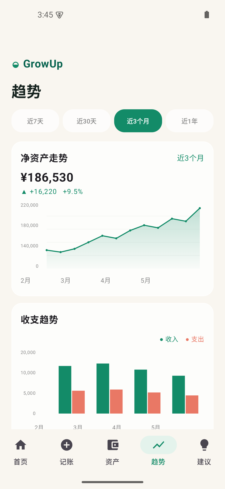
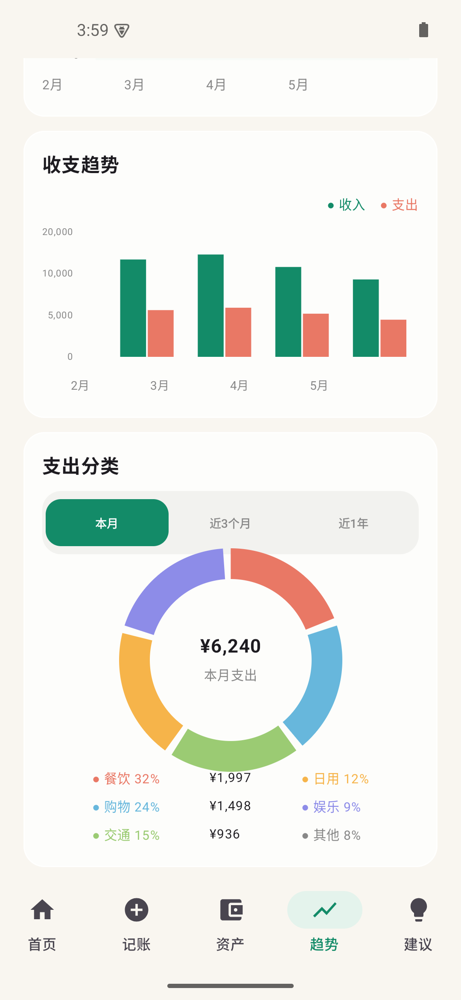

# GrowUp · 个人财富管理

GrowUp 是一款以“看清资产、记录收支、完成储蓄目标”为核心的 Android 财务管理应用原型。项目使用 Kotlin 与 Jetpack Compose 编写，采用轻盈的液态玻璃视觉风格，并内置可直接体验的示例数据。

## 下载与安装

可直接下载并安装最新调试包：[GrowUp-v0.1.0-debug.apk](releases/GrowUp-v0.1.0-debug.apk)。

> Android 设备需为 Android 8.0（API 26）或更高版本。首次从浏览器或文件管理器安装时，请在系统提示中允许该来源安装未知应用。

## 页面预览

<p align="center">
  
  
</p>

## 功能

- 首页：净资产曲线、本月现金流、最近交易及每日建议。
- 记账：录入金额、分类、账户与备注，保存后即时更新数据。
- 资产：查看现金、银行卡、投资和负债账户；支持新增账户与查看账户详情。
- 趋势：切换统计周期，查看净资产走势、收支对比及支出分类环图。
- 建议：展示应急金、消费控制等可操作的理财建议和储蓄目标。

## 运行项目

### 环境要求

- Android Studio（推荐最新版）
- JDK 17
- Android SDK 35
- Gradle 8.9 或由 Android Studio 自动管理

### 步骤

1. 克隆项目：

   ```bash
   git clone https://github.com/Steve6688/GrowUpWealth.git
   ```

2. 使用 Android Studio 打开项目根目录。
3. 等待 Gradle 同步完成，选择模拟器或 Android 设备。
4. 运行 `app` 配置，或在终端执行：

   ```bash
   ./gradlew assembleDebug
   ```

5. 生成的 APK 位于 `app/build/outputs/apk/debug/app-debug.apk`。

## 技术栈

- Kotlin
- Jetpack Compose + Material 3
- Android SDK 35（最低 API 26）
- 本地内存数据模型，适合演示核心交互流程

## 数据与隐私说明

当前版本为本地演示原型，所有预置的账户、交易与目标数据均为示例数据。项目中对未来账户连接保留了只读接口边界；不会保存银行密码，也不包含转账、支付或任何资金操作。

## 文档

- [产品需求](docs/PRD.md)
- [交互与视觉设计](docs/DESIGN.md)
- [架构说明](docs/ARCHITECTURE.md)
- [测试计划](docs/TEST_PLAN.md)

## 版本

当前版本：`0.1.0`

## 许可证

仅供学习、演示和原型验证使用。
